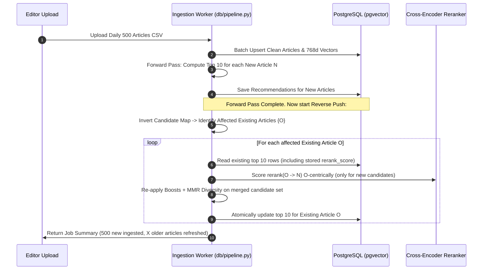
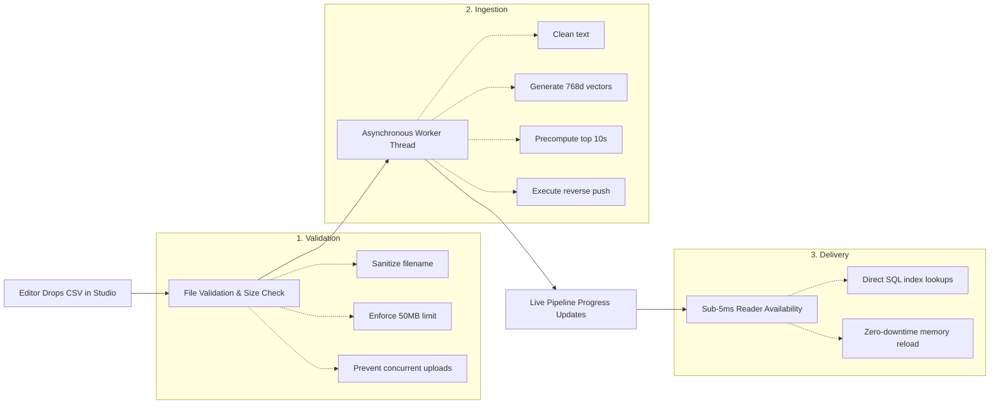

# Indian Express AI News Recommendation & Ingestion Platform (NewsRec v2.0)
## System Architecture, Algorithmic Methodology, Technical Specifications & Production Operations Manual

---

## 1. About the Project

### 1.1 Executive Overview
The **Indian Express AI News Recommender (NewsRec v2.0)** is an enterprise-grade, hybrid semantic-and-lexical recommendation engine designed specifically for modern digital newsrooms. It processes, indexes, and delivers highly relevant related articles, personalized feeds, and typo-tolerant semantic search at ultra-low latency (**sub-5ms** for precomputed reader requests).

### 1.2 Core Editorial & Technical Problems Solved
1. **Semantic Understanding vs. Exact Keyword Traps**: Traditional keyword search fails when an article discusses *"economic recession"* while a query searches for *"market slowdown"*. Conversely, pure semantic search misses critical entity names (e.g., politicians, athletes, statutory bodies). NewsRec implements **hybrid retrieval** merging both paradigms.
2. **Sub-5ms Reader Latency vs. Heavy Neural Models**: Cross-encoder neural networks are highly accurate but computationally expensive (~100–300ms per request). NewsRec resolves this by precomputing and materializing the top 10 recommendations for every article inside PostgreSQL with `pgvector`, serving reader traffic instantly from disk while reserving live neural computation for search and custom filters.
3. **The "Breaking News" Asymmetry & Stale Archive Problem**: When an editor uploads 500 new articles today, older articles in the archive would become stale if they could never recommend the new arrivals. NewsRec solves this with an **Incremental Reverse-Push Algorithm** ($O(\text{new})$ complexity) that updates only the older articles genuinely related to incoming news, without rebuilding the archive.
4. **News Domain Dynamics**: Generic recommenders fail in newsrooms because they treat a 3-year-old article the same as a 3-hour-old breaking report. NewsRec implements **dynamic exponential recency decay with category-specific half-lives**, editorial "Also Read" link recognition, and popularity calibration.
5. **Noisy News Corpus Cleanup**: Real news CMS exports contain editorial boilerplate, embedded "ALSO READ" cross-promotions, raw URLs, contact emails, and truncated headlines. NewsRec automatically sanitizes incoming text using patterns established from Exploratory Data Analysis (EDA).

### 1.3 Dual-Persona Operational Model
* **Editor Studio**: An administrative command center where editors upload daily CSV batches, inspect schema validation, monitor a live 6-stage animated neural pipeline, inspect precomputed recommendations, and view upload audit histories.
* **Reader Experience**: A user-facing reading interface featuring a trending carousel, infinite-scroll article feeds with embedded recommendations, category filtering, reading history personalization, and real-time semantic search with automatic typo correction.

---

## 2. Complete Technology Stack & Model Specifications

| Component Layer | Technology / Model Name | Specs, Parameter Count & Input Token Limits | Role & Responsibility in the Engine |
| :--- | :--- | :--- | :--- |
| **Dense Semantic Embeddings** | `BAAI/bge-base-en-v1.5` | • **Parameters**: ~109 Million<br>• **Output Dimension**: 768-d float32 vector<br>• **Max Token Length**: 256 tokens (`config.EMBED_MAX_SEQ_LEN`)<br>• **Weight Size**: ~440 MB<br>• **Normalization**: L2 normalized ($||\mathbf{v}||_2 = 1$) | Converts title + description + lead body into dense vectors. Enables semantic matching where concepts align even if vocabulary differs. Configured in `src/model_registry.py` and `src/retrieval.py`. |
| **Cross-Encoder Reranker** | `BAAI/bge-reranker-base` | • **Parameters**: ~278 Million (RoBERTa architecture)<br>• **Max Token Length**: 160 tokens (`config.RERANK_MAX_LEN`)<br>• **Weight Size**: ~1.11 GB<br>• **Scoring**: Joint self-attention over `(query, document)`<br>• **Activation**: Numerically stable Sigmoid $\sigma(x) \in [0, 1]$ | Performs deep cross-attention between source and candidate texts. Eliminates false positives from bi-encoder retrieval. Defined in `src/reranker.py`. |
| **Lexical Search (BM25)** | Custom Inverted Index + 2-Gram Hash Map | • **Parameters**: $k_1 = 1.5$, $b = 0.75$<br>• **Stopwords**: Scikit-Learn English stopword set<br>• **Vocabulary Index**: 2-gram character inverted index for fuzzy term retrieval<br>• **Doc Length**: Normalized by corpus average length | Guarantees exact matches for proper nouns, Indian entity names, bills, and places. Repeated title tokens (3x weight) ensure headline salience. Defined in `src/retrieval.py`. |
| **Lightweight Fallback** | `TfidfVectorizer` (Scikit-Learn) | • **N-gram Range**: (1, 2) unigrams & bigrams<br>• **Sublinear TF**: Applied ($\log(1 + \text{TF})$)<br>• **Norm**: L2 | Zero-dependency fallback activated automatically if GPU/neural weights are disabled via `NEWSREC_NEURAL=0` or if PyTorch fails to initialize. |
| **Relational & Vector DB** | PostgreSQL 15+ with `pgvector` | • **Vector Dimensions**: 768 float32<br>• **Index Operator**: Cosine distance operator (`<=>`)<br>• **ORM**: SQLAlchemy 2.0 with `pgvector.sqlalchemy`<br>• **Driver**: `psycopg2-binary` / `psycopg[binary]` | Stores articles, vector embeddings, precomputed top-10 recommendation lists, and ingestion job metadata. Defined in `db/models.py`. |
| **Backend Web Server** | FastAPI & Uvicorn ASGI | • **Concurrency**: Async event loop + threadpool offloading<br>• **Lifespan**: Idempotent schema migrations (`ensure_schema()`) and orphaned job recovery on startup | REST API serving JSON endpoints, streaming pipeline progress, and serving frontend static files. Defined in `api/server.py` and `api/editor_routes.py`. |
| **Frontend Architecture** | Modern Vanilla ES6+ & Modular CSS3 | • **Modules**: 7 JS modules (`api`, `state`, `ui`, `hero`, `tabs`, `editor`, `app`)<br>• **Styling**: 12 modular CSS sheets (CSS variables, dark/light theme, responsive grid)<br>• **Dependencies**: Zero external frontend frameworks | High-performance, zero-build UI with visual status badges (⚡ Precomputed vs 🛰️ Live) and a 6-stage animated pipeline diagram. |

---

## 3. Workflows, Architecture & Algorithmic Methodology

### 3.1 End-to-End System Architecture Diagram

```mermaid
flowchart TD
    subgraph Editor_Ingestion_Pipeline ["Editor Ingestion Pipeline (db/pipeline.py)"]
        CSV["Raw News CSV (e.g. 500 Daily Articles)"] --> Clean["1. Text Cleaning & Normalization\n(strip boilerplate, 'ALSO READ', URLs)"]
        Clean --> DB_Insert["2. Batched Upsert into PostgreSQL\n(articles table)"]
        DB_Insert --> Dense_Embed["3. Dense Vector Generation\n(BAAI/bge-base-en-v1.5 -> 768d)"]
        Dense_Embed --> Save_Embed["4. Store Embeddings in pgvector\n(articles.embedding)"]
        Save_Embed --> Full_Corpus["5. Load Full-Corpus Records & BM25 Index"]
        Full_Corpus --> Candidate_Retrieve["6. Hybrid Retrieval for New Articles\n(BM25 Top 50 + Dense Cosine Top 50)"]
        Candidate_Retrieve --> RRF_Fuse["7. Reciprocal Rank Fusion (RRF k=60)\n-> Top 20 Candidates"]
        RRF_Fuse --> Cross_Rerank["8. Cross-Encoder Reranking\n(BAAI/bge-reranker-base)"]
        Cross_Rerank --> Boost_MMR["9. News Boosts + MMR Diversity\n(lam=0.75, section & recency multipliers)"]
        Boost_MMR --> Save_Recs["10. Persist Top 10 to DB\n(article_recommendations table)"]
        Save_Recs --> Reverse_Push["11. Incremental Reverse-Push\n(Re-score Affected Existing Articles O-centrically)"]
        Reverse_Push --> Reload_Live["12. Zero-Downtime Live Engine Reload"]
    end

    subgraph Reader_Request_Path ["Reader Request Flow (api/server.py)"]
        UserReq["Incoming Reader Request"] --> Router{"Request Type?"}
        
        Router -- "Article-to-Article\n(Default: hybrid+rerank, top_k<=10)" --> FastCheck{"Precomputed Top 10\nin PostgreSQL?"}
        FastCheck -- "Yes (99% of feed reads)" --> Sub5ms["⚡ Sub-5ms Direct SQL Query\n(article_recommendations JOIN articles)"]
        FastCheck -- "No / Custom Filter" --> LiveEngine
        
        Router -- "Free-Text Search\nor Custom Filter" --> LiveEngine["🛰️ Live In-Memory Recommender\n(src/recommender.py)"]
        
        LiveEngine --> FuzzyBM25["Fuzzy 2-Gram BM25 Search\n(Indian entity correction)"]
        LiveEngine --> DenseSearch["Dense Cosine Search\n(bge 768d dot product)"]
        FuzzyBM25 & DenseSearch --> LiveRRF["RRF Fusion (Top 20)"]
        LiveRRF --> LiveRerank["Cross-Encoder Passage Rerank"]
        LiveRerank --> LiveBoost["News Boosts + MMR Diversity"]
        LiveBoost --> FormatOut["Format JSON with Explainability Reasons"]
        Sub5ms --> FormatOut
    end
```



---

### 3.2 Deep Methodology & Code File Breakdown

#### Step 1: Text Sanitization & Editorial Ground-Truth Extraction
* **Primary Code Locations**: `src/data_loader.py`, `db/pipeline.py`
* **Unicode Normalization**: Applies `unicodedata.normalize("NFKC", text)` to resolve inconsistent UTF-8 encodings, converts curly smart quotes (`‘’“”`) to standard ASCII quotes, and replaces em-dashes and en-dashes (`—`, `–`) with hyphens (`-`).
* **Noise Removal**: Regex passes strip raw HTTP/HTTPS URLs (`URL_RE`) and email addresses (`EMAIL_RE`).
* **"ALSO READ" Inline Stripping & Ground-Truth Mining**: News CMS systems frequently inject cross-links into body copy:
  $$\text{"...according to sources. ALSO READ Supreme Court hears plea on election commissioner... The meeting concluded..."}$$
  If left uncleaned, search models falsely treat the article as being about the Supreme Court. The function `strip_also_read()` matches `ALSO READ <headline>` against a pre-indexed 4-word title dictionary (`_headline_index`), excises the entire block from the text, and saves the target article ID into `linked_ids`. These editor-chosen links serve as real-world curation ground truth for evaluation.
* **Corpus Boilerplate Elimination**: The function `_find_boilerplate()` scans the entire corpus for sentences ($>25$ characters) repeated across $\ge 4$ articles (`config.BOILERPLATE_MIN_DOCS`), such as disclaimers, syndication notes, or newsletter prompts, and excises them from all bodies.
* **Triple Text Synthesis**:
  1. `text_embed`: `Title + Description + First 350 Body Words` (dense bi-encoder representation).
  2. `text_bm25`: `Title (3x repeated) + Description + Full Body` (title repetition boosts title token frequency for higher BM25 keyword score).
  3. `text_rerank`: `Title + Description + First 150 Body Words` (concise context window for cross-encoder).

---

#### Step 2: Lexical BM25 Search with Fuzzy Logic & Entity Expansion
* **Primary Code Location**: `src/retrieval.py` (lines 54–198)
* **Standard BM25 Scoring**:
  $$\text{Score}(D, Q) = \sum_{t \in Q} \text{IDF}(t) \cdot \frac{\text{TF}(t, D) \cdot (k_1 + 1)}{\text{TF}(t, D) + k_1 \cdot \left(1 - b + b \cdot \frac{|D|}{\text{avgdl}}\right)}$$
  Where $k_1 = 1.5$ (term frequency saturation) and $b = 0.75$ (document length penalization).

* **Fuzzy Logic & Entity Correction**:
  Real users and wire feeds introduce misspellings, typing drags, and phonetic transliterations (especially with Indian proper nouns):
  * *Repeated character drag*: `_normalize_repeats("akkhhlesh")` collapses consecutive identical characters to single instances (`"akhlesh"`).
  * *2-Gram Inverted Vocabulary Index*: When building `BM25Index`, every word in the vocabulary is padded with `#` (e.g. `"#akhilesh#"`) and mapped into a 2-gram dictionary:
    $$\text{ngrams} = \{\text{"#a"}, \text{"ak"}, \text{"kh"}, \text{"hi"}, \text{"il"}, \text{"le"}, \text{"es"}, \text{"sh"}, \text{"h#"}\}$$
    When an unknown token enters, only vocabulary terms sharing 2-grams within length difference $\pm 3$ are pulled as candidates ($O(1)$ dictionary lookups instead of scanning 50,000 words).
  * *SequenceMatcher Alignment*: Candidates are scored using Gestalt pattern matching (`difflib.SequenceMatcher.ratio()`). If the similarity ratio $r \ge 0.70$ (`FUZZY_MIN_RATIO`), the term is corrected.
  * *Adjacent Bigram Merging*: If a user enters space-split tokens (e.g., `"akkh"` + `"lesh"`), the tokenizer evaluates $t_1 + t_2$ against the 2-gram index. If the merged candidate matches a valid vocabulary term with score $\ge 0.80$, both tokens collapse into `"akhilesh"`.
  * *Fuzzy Weight Damping*: In the final BM25 scoring accumulator, fuzzy-matched terms are scaled by `FUZZY_WEIGHT = 0.85` so exact keyword occurrences take precedence over fuzzy matches.

---

#### Step 3: Dense Vector Retrieval & Semantic Search
* **Primary Code Location**: `src/retrieval.py` (lines 202–308)
* **Embedding Model**: `BAAI/bge-base-en-v1.5` processes `text_embed` into 768-dimensional vectors.
* **Short-Query Instruction Prefix**: The BGE model family requires an asymmetric task instruction when matching short queries to long documents:
  $$\text{Query} = \text{"Represent this sentence for searching relevant passages: "} + \text{raw\_query}$$
  Applied automatically if the query contains fewer than 12 words (`config.SHORT_QUERY_WORDS`).
* **Vector Normalization & Cosine Similarity**: Because all vectors are L2-normalized during embedding ($\|\mathbf{v}\|_2 = 1$), cosine similarity simplifies to a fast matrix multiplication:
  $$\text{CosineSimilarity}(\mathbf{u}, \mathbf{v}) = \mathbf{u} \cdot \mathbf{v}$$
  In PostgreSQL, this is queried using `pgvector`'s cosine distance operator `<=>` ($\text{similarity} = 1 - \text{distance}$).

---

#### Step 4: Rank Aggregation via Reciprocal Rank Fusion (RRF)
* **Primary Code Location**: `src/retrieval.py` (lines 339–350)
* **The Problem**: BM25 produces unbounded scores ($[0, \infty)$), while Dense vectors produce cosine values ($[-1, 1]$). Normalizing them by min-max scaling is sensitive to outlier spikes.
* **The Solution**: Reciprocal Rank Fusion combines ranked candidate lists purely by their positional ordinal ranks:
  $$\text{RRF\_Score}(d) = \sum_{m \in \{\text{BM25}, \text{Dense}\}} \frac{1}{k + r_m(d)}$$
  Where $k = 60$ (`config.RRF_K`) is the smoothing constant, and $r_m(d)$ is the 1-based rank position of article $d$ in system $m$. Articles that rank well across both systems gain high scores without score scale bias. The top 20 candidates are forwarded to the cross-encoder.

---

#### Step 5: Cross-Encoder Reranking & Tri-Score Relevance Blending
* **Primary Code Locations**: `src/reranker.py`, `src/recommender.py` (lines 152–175)
* **Joint Self-Attention**: While bi-encoders produce independent vectors, the cross-encoder feeds `[CLS] Query [SEP] Candidate_Doc [SEP]` through 12 cross-attention transformer layers, allowing every word in the candidate to attend directly to every word in the query.
* **Numerically Stable Sigmoid**:
  $$\text{rerank\_score} = \frac{1}{1 + e^{-\text{clip}(\text{logit}, -30.0, 30.0)}}$$
  Clamping logits between $[-30, 30]$ guarantees zero floating-point overflow.
* **Passage Centering (`_extract_query_passage`)**: For free-text queries on long articles, feeding only the first 160 words might miss the section where the query entity is discussed. NewsRec locates the first appearance of the query tokens in the body and centers a 160-word extraction window around that hit before feeding it to the cross-encoder.
* **Calibrated Relevance Blending**:
  * *Article-to-Article Mode*:
    $$\text{Relevance} = 0.55 \cdot S_{\text{rerank}} + 0.30 \cdot S_{\text{bm25\_norm}} + 0.15 \cdot S_{\text{dense\_norm}}$$
  * *Free-Text Search Mode*:
    $$\text{Relevance} = 0.65 \cdot S_{\text{rerank}} + 0.35 \cdot S_{\text{bm25\_norm}}$$

---

#### Step 6: News Domain Multiplicative Boosts
* **Primary Code Location**: `src/recommender.py` (lines 277–306)
* Boosts are applied as **calibrated multipliers** directly against relevance:
  $$\text{Final\_Score}(d) = \text{Relevance}(d) \times \prod \text{Multipliers}$$

```
Multipliers Breakdown:
├── 1. Editorial "Also Read" Link: 1.40x (Human editor curator gold-standard)
├── 2. Same Section:               1.08x (8% boost for shared top-level category)
├── 3. Same Subsection:            1.05x (5% boost for shared niche category, e.g. "Cricket")
├── 4. Log-Scaled Popularity:      1.00x - 1.06x
│      Formula: 1.0 + 0.06 * (ln(1 + pageViews) / ln(1 + maxCorpusViews))
└── 5. Dynamic Recency Decay:      1.00x - 1.10x
       Formula: 1.0 + 0.10 * (0.5 ^ (days_old / section_half_life))
```

* **Dynamic Section Half-Lives (`config.SECTION_HALF_LIVES`)**:
  * `live_blog`: **0.25 days (6 hours)** — Breaking live blogs expire rapidly.
  * `sports`: **1.0 day** — Match reports become stale after 24 hours.
  * `entertainment`: **2.0 days** — Box office and film news stay fresh for 48 hours.
  * `business`: **3.0 days** — Market and policy analyses remain relevant for 3 days.
  * `brand-story`: **4.0 days** — Sponsored features maintain extended shelf lives.
  * `default`: **2.0 days**.

---

#### Step 7: Maximal Marginal Relevance (MMR) Diversity
* **Primary Code Location**: `src/recommender.py` (lines 308–326)
* **The Near-Duplicate Problem**: Major wire services (PTI, ANI, Reuters) publish identical coverage with minor headline variations. Presenting 5 near-identical articles degrades reader engagement.
* **The Gated MMR Formula**:
  $$\text{MMR}(i) = \lambda \cdot \text{Final\_Score}(i) - (1 - \lambda) \cdot \max_{j \in \text{Selected}, \, \text{Sim}(i, j) > \theta} \text{Sim}(i, j)$$
  Where:
  * $\lambda = 0.75$ (`config.MMR_LAMBDA`) balances relevance vs diversity.
  * $\theta = 0.80$ (article mode) or $0.85$ (search mode) is the similarity activation threshold.
  * $\text{Sim}(i, j) = \mathbf{e}_i \cdot \mathbf{e}_j$ is the cosine similarity matrix of dense embeddings.
  * The penalty applies **only** when candidate $i$ is truly redundant ($\text{Sim} > \theta$) with an already selected article $j$. Distinct articles are not penalized.

---

#### Step 8: Incremental Reverse-Push Maintenance
* **Primary Code Location**: `db/pipeline.py` (lines 193–310)
* **The Asymmetry Challenge**:
  When new article $N$ is uploaded, we precompute its top 10 against the whole archive. However, existing article $O$ (uploaded yesterday) already has an established top 10. If $N$ is deeply relevant to $O$, $O$'s recommendations become outdated unless updated.
* **The $O(\text{new})$ Solution**:
  1. We invert the candidate map: for every new article $N$, any existing article $O$ that appeared in $N$'s top candidates is flagged as an affected neighbour.
  2. For each affected $O$, we load its stored recommendations and read their **raw `rerank_score`** (persisted specifically for this purpose).
  3. We add $N$ to $O$'s candidate pool and run the cross-encoder **O-centrically** (source $O$ as the query, $N$ as the document).
  4. The candidate pool is merged, news boosts and MMR diversity are re-applied, and the top 10 for $O$ is saved back to PostgreSQL.
  5. Unaffected older articles are never touched, ensuring processing scales strictly with the size of the uploaded batch, not the size of the entire database archive.



---

## 4. Simple Terms Walkthrough: How the Pipeline Works

To explain this workflow without machine learning jargon, imagine a team of newsroom specialists:

1. **The Cleaning Editor (`data_loader.py`)**:
   Cleans up wire copy. Removes ads, disclaimers, email addresses, and cross-promotional links ("ALSO READ...") so they do not confuse downstream analysis.
2. **The Lexical Researcher (BM25 Search)**:
   Scans the archive for exact names, match scores, and specific quotes. If an editor misspelled a name like *"skhilesh"* or *"virat koli"*, a 2-gram dictionary identifies the intended entity (*Akhilesh Yadav*, *Virat Kohli*) and retrieves matching articles.
3. **The Conceptual Analyst (Dense Vector Search)**:
   Understands the semantic meaning behind the text. Knows that an article about *"inflation, interest rate hikes, and rupee depreciation"* is conceptually tied to *"RBI monetary policy"*, even if those exact words never appear.
4. **The Ranking Committee (Reciprocal Rank Fusion - RRF)**:
   Merges the findings from both researchers. Articles that appear high on both lists rise to the top 20 candidates.
5. **The Senior Editor (Cross-Encoder Reranker)**:
   Reads the lead paragraph of the current article alongside the candidate articles, comparing their full context to determine if they cover the same ongoing story.
6. **The Newsroom Multipliers (News Boosts)**:
   Applies editorial common sense:
   * Did an editor manually link these stories? (**+40% boost**)
   * Are they in the same category and sub-category? (**+8% and +5% boost**)
   * Is the candidate fresh and currently trending? (**Up to +10% recency boost and +6% view boost**)
7. **The Variety Curator (MMR Diversity)**:
   Prevents repetitive content. If three articles cover the exact same wire report, only the most comprehensive version is kept, reserving the remaining recommendation slots for related background coverage.
8. **The Archive Assistant (Reverse-Push)**:
   Ensures older stories link to breaking updates. When today's election results arrive, the system updates yesterday's preview articles so readers are directed to the latest outcome.

---

## 5. Deep Technical Implementation & Database Architecture

### 5.1 Database Schema & PostgreSQL pgvector Configuration
The platform relies on PostgreSQL with the `pgvector` extension across three primary tables defined in `db/models.py`:

```sql
-- 1. Enable pgvector extension
CREATE EXTENSION IF NOT EXISTS vector;

-- 2. Core News Articles Table
CREATE TABLE articles (
    id VARCHAR(100) PRIMARY KEY,
    title TEXT NOT NULL,
    description TEXT,
    body TEXT,
    section VARCHAR(100),
    subsection VARCHAR(100),
    date TIMESTAMPTZ,
    url TEXT,
    image TEXT,
    is_live BOOLEAN DEFAULT FALSE,
    page_views INTEGER DEFAULT 0,
    unique_users INTEGER DEFAULT 0,
    linked_ids TEXT,             -- JSON array of editorial 'Also Read' article IDs
    text_embed TEXT,             -- Sanitized title + desc + 350 body words
    text_bm25 TEXT,              -- 3x Title + desc + body
    text_rerank TEXT,            -- Title + desc + 150 body words
    embedding vector(768),       -- BAAI/bge-base-en-v1.5 dense vector
    created_at TIMESTAMP DEFAULT NOW(),
    updated_at TIMESTAMP DEFAULT NOW()
);

-- Indexing for high-speed metadata filtering
CREATE INDEX idx_articles_section ON articles(section);
CREATE INDEX idx_articles_date ON articles(date DESC NULLS LAST);

-- 3. Precomputed Top 10 Recommendations Table (Sub-5ms Lookups)
CREATE TABLE article_recommendations (
    id SERIAL PRIMARY KEY,
    article_id VARCHAR(100) NOT NULL REFERENCES articles(id) ON DELETE CASCADE,
    recommended_article_id VARCHAR(100) NOT NULL REFERENCES articles(id) ON DELETE CASCADE,
    rank INTEGER NOT NULL,       -- 1 to 10
    score DOUBLE PRECISION,      -- Final blended score shown in UI (0.0 to 1.0)
    rerank_score DOUBLE PRECISION, -- Raw cross-encoder probability for incremental reverse updates
    method VARCHAR(50) DEFAULT 'neural_hybrid_rerank',
    reason TEXT,                 -- Human-readable explainability string
    created_at TIMESTAMP DEFAULT NOW(),
    CONSTRAINT uq_source_article_rank UNIQUE (article_id, rank)
);

CREATE INDEX idx_rec_source_rank ON article_recommendations(article_id, rank);

-- 4. Asynchronous Ingestion Job Tracker (Editor Studio)
CREATE TABLE ingestion_jobs (
    id VARCHAR(64) PRIMARY KEY,
    filename VARCHAR(255) NOT NULL,
    status VARCHAR(50) DEFAULT 'pending', -- pending, processing, completed, failed
    total_articles INTEGER DEFAULT 0,
    processed_articles INTEGER DEFAULT 0,
    refreshed_articles INTEGER DEFAULT 0, -- Count of existing articles reverse-updated
    message TEXT,
    error TEXT,
    created_at TIMESTAMP DEFAULT NOW(),
    updated_at TIMESTAMP DEFAULT NOW()
);
```

### 5.2 The Dual-Score Storage Rationale
A key design choice in `article_recommendations` is storing two separate score metrics:
1. `score`: The post-boost, post-MMR final score displayed in the user interface.
2. `rerank_score`: The raw, unboosted cross-encoder probability ($\sigma(\text{logit})$) computed specifically with the source article as query.

*Why this matters*: When an incremental reverse-push occurs later, comparing candidate scores requires using identical evaluation criteria. Storing the raw `rerank_score` allows the system to compare existing recommendations directly against new candidates without having to rerun the cross-encoder over the older entries.

### 5.3 In-Memory vs. Database Caching Mechanisms
* **Disk Embedding Cache (`DenseIndex._load_or_build`)**: In local development or standalone Python runs, embeddings are hashed by file timestamp and row count into `data/cache/embeddings_<hash>.npy`. A master incremental cache `data/cache/text_embedding_cache.npz` stores SHA-256 hashes of individual texts so that unchanged articles are never re-encoded.
* **Atomic Engine Reload Mutex (`_reload_lock`)**: In `api/server.py` (lines 82–136), `reload_engine_from_postgres()` loads all stored records and pre-calculated vectors into memory, instantiating a fresh `Recommender` object before pointing the global reference `rec` to it. This provides seamless, zero-downtime updates while queries continue executing.

### 5.4 Confidence Thresholds ("No Good Match" Safety)
To prevent the engine from returning irrelevant results when a query has no matching coverage in the dataset (e.g., searching for *"flight crash"* when the corpus contains no aviation disaster reports), `config.py` (lines 99–103) enforces minimum relevance thresholds:
* `reranker`: `0.05` minimum probability
* `dense`: `0.50` minimum cosine similarity
* `tfidf`: `0.08` minimum cosine similarity

If the top-ranked candidate falls below the threshold, the API flags `low_confidence: true`. The UI then displays a clear notice (*"No close match found"*) rather than presenting low-relevance results.

---

## 6. Production Operations: Daily Ingestion of 500 Articles

### 6.1 Daily Workload Execution Profile (500 Articles)

```
========================================================================================
STAGE                          COMPUTE / ALGORITHM                ESTIMATED TIME (CPU / GPU)
========================================================================================
1. Parse & Validate CSV        Pandas chunked read + Schema map   < 1.0 sec
2. Clean & Normalize Text      Regex, Boilerplate, "Also Read"    1.5 - 2.5 sec
3. PostgreSQL Bulk Upsert      INSERT ... ON CONFLICT (chunk 500) < 1.0 sec
4. 768d Vector Embeddings      bge-base-en-v1.5 (batch 32, n=500) 15 - 25s (CPU) / 2s (GPU)
5. Full Corpus Inverted Index  In-memory BM25 rebuild             < 1.0 sec
6. Precompute Forward (N)      500 articles * 20 pairs = 10k CE   150 - 220s (CPU) / 15s (GPU)
7. Reverse-Push Update (O)     ~150 affected old arts (~1.2k CE)  20 - 35s (CPU) / 3s (GPU)
8. Live Engine Reload          Atomic in-memory pointer swap      < 0.5 sec
----------------------------------------------------------------------------------------
TOTAL PIPELINE TIME:                                              ~3 to 4.5 mins (CPU)
                                                                  < 35 seconds (GPU)
========================================================================================
```

### 6.2 Step-by-Step Daily Ingestion Lifecycle



1. **Upload & Guardrails (`/api/db/upload-csv`)**:
   * The editor selects or drags a CSV into the Editor Studio.
   * The API checks for active jobs using `ArticleRepository.get_active_job(db)`. If another job is running, it returns HTTP 409 Conflict to prevent concurrent workloads from competing for resources.
   * The file is streamed in 1MB chunks with a strict 50MB security ceiling (`MAX_FILE_SIZE`).
   * A persistent `IngestionJob` record is created with a unique ID (`job_xxxxxx`).

2. **Asynchronous Background Execution**:
   * The FastAPI server dispatches `run_ingestion_pipeline` onto a detached daemon thread.
   * The HTTP response returns immediately (`{"status": "processing", "job_id": "job_12345"}`), keeping the editor interface responsive.

3. **Live Progress Monitoring & Event Streaming**:
   * The frontend polls `/api/db/jobs/{job_id}` every 1,500ms.
   * `db/pipeline.py` formats status messages using standardized prefixes:
     `STAGE:PARSE`, `STAGE:CLEAN`, `STAGE:STORAGE`, `STAGE:EMBEDDING`, `STAGE:RERANK`, `STAGE:REVERSE`, `STAGE:COMPLETE`.
   * The Editor Studio visually tracks progress across the 6-stage pipeline diagram while rendering real-time execution logs with estimated completion times.

4. **Forward Precomputation & Incremental Reverse-Push**:
   * **Forward pass**: The 500 new articles retrieve candidates from the entire database, precomputing and writing their top 10 recommendations to `article_recommendations`.
   * **Reverse-push**: The system identifies older articles affected by the new batch (typically 100–300 articles). For these, it evaluates the new articles O-centrically, merges them into the existing lists, re-applies boosts and MMR diversity, and updates the database.

5. **Live Recommender Synchronization**:
   * Once database commits finish, the worker calls `reload_engine_from_postgres()`.
   * The in-memory search index updates atomically under a thread lock.
   * Readers immediately receive updated recommendations across both the precomputed SQL path (sub-5ms) and the live search engine without downtime.

---

## 7. System Verification & File Location Reference

To inspect or tune any part of the platform, refer to the source files below:

| Functional Responsibility | Primary Source File | Key Functions / Classes to Inspect |
| :--- | :--- | :--- |
| **Central Settings & Tuning** | `config.py` | `EMBEDDING_MODEL`, `SECTION_HALF_LIVES`, `MMR_LAMBDA`, `MIN_RELEVANCE`, `PRECOMPUTE_CANDIDATES` |
| **Data Cleaning & Boilerplate** | `src/data_loader.py` | `load_articles()`, `strip_also_read()`, `_find_boilerplate()`, `normalise_text()` |
| **Fuzzy Matching & BM25** | `src/retrieval.py` | `BM25Index.normalize_query()`, `BM25Index.find_best_vocab_match()`, `reciprocal_rank_fusion()` |
| **Vector & TF-IDF Indexing** | `src/retrieval.py` | `DenseIndex._load_or_build()`, `DenseIndex.scores_for_text()`, `TfidfIndex` |
| **Cross-Encoder Model** | `src/reranker.py` | `Reranker.score()`, `_get_reranker_model()` |
| **Full Recommendation Logic** | `src/recommender.py` | `Recommender.recommend()`, `_boost_mult()`, `_mmr()`, `_explain()` |
| **SQLAlchemy ORM Models** | `db/models.py` | `Article`, `ArticleRecommendation`, `IngestionJob` |
| **Database Repositories** | `db/repository.py` | `ArticleRepository.search_similar_by_vector()`, `get_precomputed_recommendations()` |
| **Ingestion & Reverse-Push** | `db/pipeline.py` | `run_ingestion_pipeline()`, `_reverse_push_for_old()`, `_precompute_for_article()` |
| **REST Endpoints & Server** | `api/server.py` | `recommend()`, `reload_engine_from_postgres()`, `get_articles()` |
| **Editor Routes & Uploads** | `api/editor_routes.py` | `upload_csv()`, `get_job_status()`, `clear_database()` |
| **Frontend Shell & Logic** | `frontend/index.html`, `frontend/js/editor.js` | Dual-role switcher, animated 6-stage visual pipeline tracker, inspector tables |
